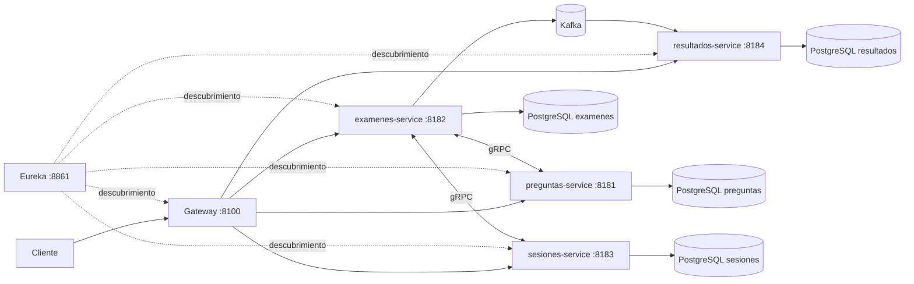

# Arquitectura del proyecto

## Contexto y objetivos

ExamenLive es una plataforma para gestionar exámenes en línea, preguntas,
sesiones en vivo y resultados. La solución separa cada subdominio en un
microservicio Spring Boot con su propia persistencia y ciclo de despliegue.
Esta separación permite que el catálogo de preguntas, la ejecución del
examen, la participación en una sesión y la generación de resultados
evolucionen de forma independiente.

El gateway es el punto de entrada HTTP para los clientes. Eureka mantiene el
registro y descubrimiento de los servicios. Las operaciones que necesitan
respuesta inmediata usan HTTP o gRPC; los cambios que deben propagarse sin
acoplar transacciones entre servicios usan Kafka y el patrón outbox.

## Servicios y responsabilidades

| Servicio | Responsabilidad | Puerto HTTP | Puerto adicional |
|---|---|---:|---:|
| preguntas-service | Catálogo de preguntas y opciones | 8181 | gRPC 9191 |
| examenes-service | Exámenes, intentos y comunicación con otros contextos | 8182 | gRPC 9192 |
| sesiones-service | Sesiones en vivo y participantes | 8183 | gRPC 9193 |
| resultados-service | Calificación y consulta de resultados | 8184 | — |
| gateway | Entrada y enrutamiento HTTP | 8100 | — |
| eureka-server | Registro y descubrimiento | 8861 | — |

## Diagrama

## Decisiones transversales

Cada servicio organiza el código en dominio, aplicación e infraestructura.
Las referencias a otros contextos se expresan mediante identificadores o
proyecciones locales, no mediante entidades compartidas. Las migraciones
Flyway definen el esquema de cada base de datos. Los eventos publicados desde
la misma transacción se almacenan en outbox y se procesan con inbox e
idempotencia para evitar efectos duplicados. Los clientes gRPC tienen
timeouts, y Eureka y Kafka se configuran mediante variables de entorno para
permitir ejecución local y despliegue independiente.
